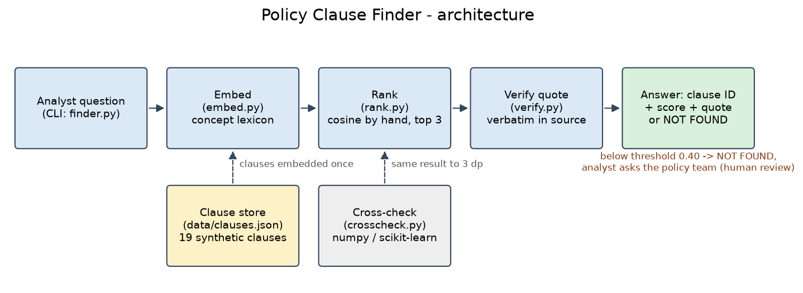

# Capstone 1 – Policy Clause Finder

CGI GenAIOps Programme · Weekly Mini-Capstone 1 · set Fri 30-Oct-2026 (Day 6), due Mon 2-Nov-2026 (Day 7 session).
All data is synthetic (a fictional bank). No API key is needed, and none is in this folder.

## Purpose

**Problem.** Bank operations analysts spend a long time hunting through policy documents for the one clause that
answers a customer's query, and keyword search fails when the customer's words differ from the policy's words
("cannot pay my EMI" versus "repayment default").

**Outcome.** A command-line tool that turns each policy clause and the analyst's question into vectors, ranks the
clauses by cosine similarity and returns the top three. Each result has its clause ID, score and a quote checked
word for word against the source. If no clause is close enough, the tool says "not found" instead of guessing.

## Architecture



| Component | File | Purpose |
|---|---|---|
| Clause store | `data/clauses.json` | 19 synthetic clauses (loans, cards, complaints, KYC, accounts), each with ID, category, title and text; 4 near-duplicate pairs marked `near_duplicate_of` |
| Embedder | `embed.py` | Turns text into a 51-number vector: 19 banking concepts plus 32 hashed-word dimensions (see below) |
| Ranker | `rank.py` | `dot`, `norm`, `cosine_similarity` and `euclidean_distance` written by hand (no numpy); returns the top 3 |
| Cross-check | `crosscheck.py` | Compares the hand-written cosine with numpy (and scikit-learn if installed) on two examples |
| Verifier | `verify.py` | Picks the clause sentence that best matches the question and confirms it appears **verbatim** in the source clause; an unverified quote is never shown |
| CLI | `finder.py` | Entry point: ask a question, get ranked clauses, or "not found" below the threshold |
| Evaluation | `evaluate.py` | Runs the test questions and writes `results/test_results.md` with honest counts |
| Tests | `tests/test_clause_finder.py` | 23 unit tests: maths, embedder, verifier, clause store, end to end |

### The embedder, and why

The brief allows "local embedding or the simple lab embedder". A real local model (fastembed `bge-small`, as in the
Day 2 lab) cannot run on the build machine: `onnxruntime` fails to load because the Microsoft Visual C++ runtime is
missing. So `embed.py` builds the lab-style embedder for banking:

* **19 concept dimensions** (repayment trouble, loan, card, fee/charge, fraud, merchant dispute, complaint, time
  limit, identity, address, hardship, early settlement, lost/stolen, credit limit, closure, dormant, rate change,
  business, vulnerable customer). Each concept has a list of words and short phrases. "cannot pay" adds to
  *repayment trouble* and "EMI" to *loan*, the same dimensions the clause's "unpaid … repayment default … loan"
  adds to. That is how the tool connects words that keyword search cannot.
* **Longest phrase wins**: "lost my job" is read as *hardship*, not as "lost" (*lost/stolen card*) + "job".
* Light **stemming** (charged / charges / charge → one token) and contractions ("can't" → "cannot").
* **32 hashed-word dimensions**: a word no concept knows still nudges one dimension a little (weight 0.3), so
  specific words count for something.
* Standard library only, so the tool runs from a fresh clone with no downloads.

### Cosine, not Euclidean

Clause vectors are long (a clause has many words) and question vectors are short. Euclidean distance mostly measures
that difference in length, so it ranks the shortest clauses first whatever the question. Cosine compares only the
direction (which concepts, in which mix). Measured on the 8 test questions: **cosine 8/8, Euclidean 0/8**. On
unit-length vectors Euclidean ranks exactly like cosine (8/8), because then d² = 2 − 2·cos (the Day 3 identity).

## How to run (fresh clone)

Needs Python 3.10 or newer.

```bash
cd capstone-1
python -m venv .venv
# Windows:  .venv\Scripts\activate        macOS/Linux:  source .venv/bin/activate
pip install -r requirements.txt           # numpy, for the library cross-check

python finder.py "Customer says they cannot pay their EMI this month. What happens to the loan?"
python finder.py "I paid my credit card bill two days late, will I be charged anything?" --explain
python finder.py "What time does the staff canteen open on Fridays?"      # -> NOT FOUND
python finder.py --interactive                                            # ask several questions

python crosscheck.py                          # hand-written cosine vs numpy / scikit-learn
python evaluate.py                            # test table -> results/test_results.md
python -m unittest discover -s tests -v       # 23 unit tests
```

Options: `--top N` (default 3), `--threshold X` (default 0.40), `--explain` (show the concepts recognised), `--json`.

Example output (`results/live_run_1_normal.txt`):

```
 #1  LN-01  Missed instalment and repayment default
      cosine 0.848   (euclidean distance 9.680)
      Quote [verified in LN-01]: "If any amount remains unpaid for 90 days, the loan is classified as a
      repayment default and the default is reported to the credit reference agencies."
 #2  LN-04  Late payment charge on loans
      cosine 0.798   ...
```

## Results

Full table: [`results/test_results.md`](results/test_results.md). All counts are from `python evaluate.py`.

| Test set | Ranking | Right first time | In top 3 |
|---|---|---|---|
| **8 test questions** (brief, step 6) | **the tool: concept embedder + cosine** | **8/8** | 8/8 |
| 8 test questions | keyword baseline (no synonyms) + cosine | 3/8 | 6/8 |
| 8 test questions | concept embedder + Euclidean distance | 0/8 | 0/8 |
| 8 test questions | concept embedder, unit-length vectors + Euclidean | 8/8 | 8/8 |
| **6 stress questions** (unseen wording, not tuned) | the tool | **1/6** | 6/6 |
| 2 out-of-scope questions | must answer "not found" | 2/2 | – |

| # | Test question | Expected | Tool's top 3 (cosine) | Right first time |
|---|---|---|---|---|
| Q1 | Customer says they cannot pay their EMI this month. What happens to the loan? | LN-01 | LN-01 0.848, LN-04 0.798, LN-03 0.466 | yes |
| Q2 | Customer lost their job and wants a break from loan payments for a while | LN-02 | LN-02 0.962, LN-04 0.282, LN-01 0.276 | yes |
| Q3 | There is a purchase on my card that I never made | CC-02 | CC-02 0.755, CC-01 0.494, CC-03 0.405 | yes |
| Q4 | I paid my credit card bill two days late, will I be charged anything? | CC-03 | CC-03 0.793, CP-02 0.547, LN-04 0.518 | yes |
| Q5 | How long does the bank have to reply to my complaint? | CP-01 | CP-01 0.951, CP-02 0.937, CP-03 0.559 | yes |
| Q6 | I have moved house recently, what do I need to send you? | KY-03 | KY-03 0.725, KY-02 0.203, KY-04 0.147 | yes |
| Q7 | Is there a penalty if I pay off my personal loan early? | LN-03 | LN-03 0.945, LN-05 0.462, LN-04 0.439 | yes |
| Q8 | The shop never delivered the item I paid for with my card | CC-04 | CC-04 0.958, CC-02 0.393, CC-03 0.323 | yes |

Every quote shown, for every question, was verified verbatim in its source clause.

### What failed, and why (stress set)

The 8 main questions and the lexicon were written by the same person, so 8/8 is optimistic. To be honest about
that, 6 stress questions were written **after** the main set had scored, using words the lexicon does not know, and
the lexicon was **not** changed afterwards. Result: **1/6 right first time**, although the right clause was in the top
3 every time.

| # | Question | Expected | Got first | Why it failed |
|---|---|---|---|---|
| S2 | Bigger spending allowance on my credit card? | CC-05 | CC-01 | "spending allowance" ≠ "credit limit"; only *card* recognised |
| S3 | Husband passed away, how quickly will you deal with my complaint? | CP-03 | CP-02 | "passed away" ≠ "bereavement"; "how quickly" ≠ "how long" |
| S4 | Haven't touched my savings account in three years, now frozen | AC-02 | not found (0.269) | "haven't touched" ≠ "no transactions", "frozen" ≠ "dormant"; a safe failure: below threshold, so not answered |
| S5 | Putting up the interest on my loan, can I get out of it? | LN-05 | LN-04 | "putting up" ≠ "increase"; "get out of it" ≠ "repay in full" |
| S6 | Limited company, how often do you check who owns us? | KY-04 | CC-05 | "owns us" ≠ "beneficial owner"; "check" ≠ "re-verify" |

The pattern: the tool is only as good as the synonyms in its lexicon. That is limitation 1 below.

### Choosing the threshold (0.40)

* Out-of-scope questions (canteen hours, email password) score at most **0.255**.
* The 8 main questions score at least **0.725**.
* **0.40** sits in that gap with a margin on both sides. Below it the tool prints NOT FOUND and sends the analyst to
  the policy team instead of showing a weak match as an answer. One stress question (S4, 0.269) falls below it: the
  tool says "not found" rather than giving a wrong clause, which is the safe way to fail.
* Change it with `--threshold`. A higher value gives fewer wrong answers and more "not found".

## Safety and human review

* Synthetic clauses and questions only: a fictional bank, no real customer data. No `.env` and no keys (the tool
  calls no external API).
* A quote is shown only if it is found character for character in the clause store. Otherwise it is withheld.
* Below the threshold the tool refuses to answer and points to the policy team.
* Every answer ends with a human-review line: the analyst reads the full clause before replying. Similarity means
  "same topic", not "this answers the question". Opposite statements can score high (Day 3, Task E).

## Limitations

1. **The embedder only knows the synonyms in its lexicon.** New wording ("passed away", "spending allowance") is
   missed: 1/6 on the stress set. The lexicon is also hand-written by the same person who wrote the tests, so the
   8/8 on the main set is optimistic.
2. **Near-duplicates and negation are not understood.** Clauses on the same topic score close together (Q5: CP-01
   0.951 vs CP-02 0.937), and the vectors carry no meaning for "not" or for numbers. The tool finds the topic; it
   cannot tell which clause is the correct decision. The analyst must read it.

## One idea to improve

Replace the concept lexicon with a real local embedding model (fastembed `bge-small-en-v1.5`, 384 dimensions: one
line in `embed.py` once the Visual C++ runtime is installed). Keep the hand-written ranker, the verifier and the
threshold, and re-run `evaluate.py` on the same 8 + 6 questions to compare honestly. A model trained on general
English should catch "passed away" ≈ "bereavement" without anyone writing a synonym list. The threshold must then be
re-chosen, because model scores sit on a different scale.

## Acceptance checklist

- [x] Runs end to end from the command line on a fresh clone (checked in a new copy with a new virtual environment)
- [x] Top-3 results show clause ID, score and verified quote
- [x] Cosine written by hand and matches the library to 3 decimal places (`results/crosscheck.txt`: 0.848265 and
      0.792565, identical to numpy and scikit-learn)
- [x] Test table of 8 questions with honest results (plus a 6-question stress set that mostly fails, reported as is)
- [x] Only synthetic data; no `.env` or keys in the repository

## Folder contents

```
capstone-1/
├── README.md                  this file
├── finder.py                  CLI entry point
├── embed.py                   embedders (concept lexicon; keyword baseline)
├── rank.py                    hand-written dot / norm / cosine / euclidean + top-k
├── verify.py                  quote selection and verbatim check
├── crosscheck.py              hand-written maths vs numpy / scikit-learn
├── evaluate.py                test questions -> results/test_results.md
├── requirements.txt           numpy (cross-check only)
├── .gitignore                 .env, venv, caches
├── data/
│   ├── clauses.json           19 synthetic policy clauses
│   └── test_questions.json    8 test questions, 6 stress questions, 2 out-of-scope
├── docs/
│   ├── architecture.png       architecture diagram
│   ├── make_diagram.py        redraws the diagram (needs matplotlib)
│   └── WALKTHROUGH.md         script for the 8-minute trainer walkthrough
├── results/
│   ├── test_results.md        full evaluation tables
│   ├── crosscheck.txt         library cross-check output
│   ├── unit_tests.txt         23/23 unit tests
│   └── live_run_*.txt         normal, tricky and not-found runs
└── tests/test_clause_finder.py
```
